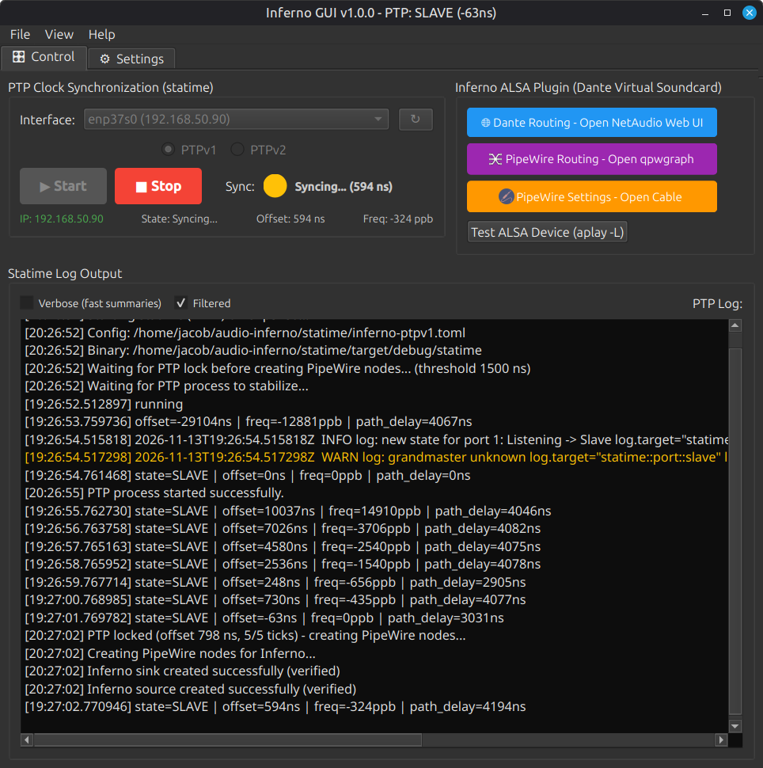
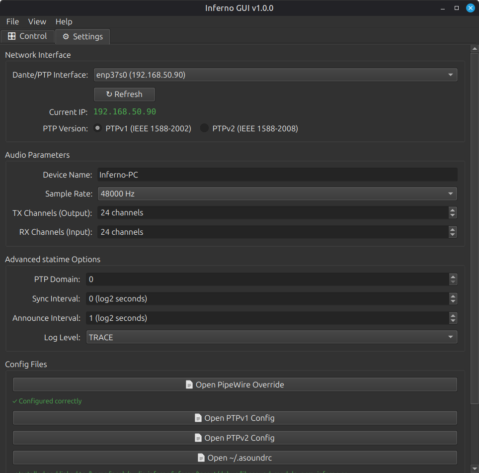

# Inferno GUI

A Linux desktop application for easy installing and managing **Inferno** – a Dante/AES67 virtual soundcard alternative for Linux using PipeWire.

## Features

- **Installation script**: easy installation
- **PTP Clock Control**: Start/stop statime (PTPv1/PTPv2) with live filtered log output
- **Interface Selection**: Dropdown with available network interfaces and IP display
- **Audio Configuration**: Sample rate, TX/RX channels, device name, bind IP
- **Real-time Status**: Sync traffic light (green ≤200ns, yellow ≤1000ns, red) with offset/frequency display
- **Log Filtering**: Reduces verbose statime output to ~1 line/second with key metrics
- **System Tray**: Minimize to tray, quick start/stop from tray menu
- **NetAudio Integration**: One-click launch of Dante web routing interface
- **Settings Persistence**: Remembers interface, PTP version, audio parameters
- **About Dialog**: Credits for Inferno/statime (by teodly) and GUI (MIT licensed)

## Screenshots






## Requirements

| Component | Version | Purpose |
|-----------|---------|---------|
| Python | ≥ 3.10 | Runtime |
| PyQt6 | ≥ 6.5 | GUI Framework |
| PipeWire | ≥ 1.4.11 | Audio backend |
| statime | (built from source) | PTP/IEEE 1588 daemon |
| inferno | (built from source) | ALSA plugin for Dante/AES67 |
| linuxptp tools | Optional | ptp4l alternative |

> **Installation script requirements:** Debian/Ubuntu-based (Linux Mint tested). Uses `apt` package manager and Debian-style library paths.

## Installation

### Supported Distributions

> ⚠️ **Note:** The installation script (`install_inferno.sh`) is designed for **Debian/Ubuntu-based distributions** (tested on **Linux Mint**). It uses `apt` for package management and assumes Debian-style paths (e.g., `/usr/lib/x86_64-linux-gnu/alsa-lib/`). For other distributions (Arch, Fedora, openSUSE, etc.), you'll need to adapt the package names and paths manually.

### 1. Install Inferno & statime (one-time)

Run the provided installation script:

```bash
sudo ./install_inferno.sh
```

This script will:
- Update system and install dependencies
- Build PipeWire ≥ 1.4.11 if needed
- Install Rust toolchain
- Build statime and inferno from source
- Configure network interface for PTP
- Set up ALSA plugin and PipeWire integration
- Optionally install netaudio, Cable, and Millisecond

**Test mode** (dry-run, no system changes):
```bash
./install_inferno.sh --test-mode
```

### 2. Install the GUI

```bash
cd inferno-gui
pip install -e .
```

Or run directly:
```bash
sudo python3 -m inferno_gui
```

## Usage

1. **Launch the GUI** (requires root for PTP hardware timestamping):
   ```bash
   sudo inferno-gui
   # or
   sudo python3 -m inferno_gui
   ```

2. **Configure Settings** (Settings tab):
   - Select your Dante network interface
   - Choose PTP version (v1 or v2)
   - Set audio parameters (sample rate, channels)
   - Save configuration

3. **Start PTP** (Control tab):
   - Click **START PTP** to launch statime
   - Watch the sync indicator: green = excellent (≤200ns), yellow = good (≤1000ns), red = poor
   - View filtered log output (1 line/sec with offset/freq/state)

4. **Use Inferno**:
   - The ALSA plugin activates automatically when an app opens the "inferno" PCM device
   - In your DAW/audio software, select "Inferno" as audio device
   - Route audio via **NetAudio Web UI** (button in Control tab or tray menu)

5. **System Tray**:
   - Close window → minimizes to tray (PTP keeps running)
   - Double-click tray icon → show window
   - Right-click tray → quick Start/Stop PTP, open NetAudio, quit

## Configuration Files

| File | Purpose |
|------|---------|
| `~/.asoundrc` | Inferno ALSA plugin configuration |
| `~/audio-inferno/statime/inferno-ptpv1.toml` | statime PTPv1 config |
| `~/audio-inferno/statime/inferno-ptpv2.toml` | statime PTPv2 config |
| `~/.config/systemd/user/pipewire.service.d/override.conf` | PipeWire @clock override |

## Architecture

Following the **Sync67** design principles:
- **Strict separation** of GUI and functionality (core/ vs ui/)
- **PyQt6** with modern styling (dark theme)
- **QProcess** for subprocess management
- **QSettings** for persistent configuration
- **Log parsing** with filtering (1 line/sec summary)
- **System tray** integration for background operation

## Notes
The app was made with heavy usage of various LLMs.

## Credits

- **Inferno & statime**: by [teodly](https://github.com/teodly) – the core audio/PTP implementation
- **GUI**: by jayxcfgj – MIT licensed
- **Inspired by**: [Sync67](https://github.com/jayxcfgj/sync67) by jayxcfgj

## License

MIT License – see LICENSE file for details.
